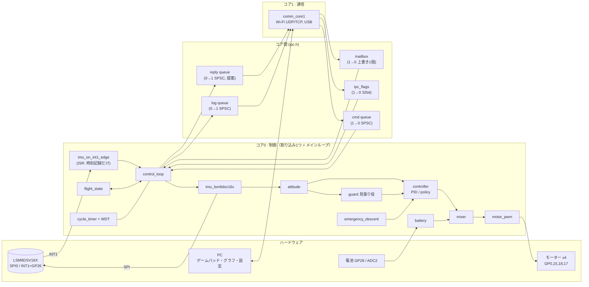

# 初代C ファームウェア構成（ステップ① モジュール構成とヘッダ）

正本は設計メモ rev14、その後の決定は rev22（2026-11-08。姿勢推定・PID・ミキサー・推力換算）。食い違ったら rev22 が優先。メモにないことは「提案」と明記した。ヘッダは `firmware/include/`、実装は `firmware/src/`（ステップ②でIMU、③aで制御の信号の流れ、③bで状態遷移・安全・制御ループまで。進み具合は4章の表）。
章番号「メモN章」は設計メモの章を指す。

## ステップ②の前にオーナーに決めてほしいこと（優先順）

1. ~~**FIFO_WTM の単位**~~ → 決定（2026-11-07）: WTM=16（8組＝16ワード）。ステップ②で INT1 が約940Hz で来ることを確認する（A#4）。
2. ~~**方策の入力数**~~ → 決定（2026-11-07）: 入力14（14→64→64→4、5248積和）（A#2）。
3. ~~**旗とメールボックスの重なり**~~ → 決定（2026-11-07）: 設計メモのまま。PC→機体は3つとも操縦パケットの旗。コア1→0は、アーム要求はメールボックス（スロットルと同じパケットで判断、取りこぼしても次で届く）、非常停止・ディスアームは ipc_flags にも出す（必ず届ける）（A#3）。

## 1. 全体像



### データの流れ（要点）

| 流れ | 中身 | 形 |
| --- | --- | --- |
| IMU → 姿勢 | `imu_batch_t`（通常8組、最大32組） | 関数の引数（コア0内） |
| 姿勢 → 制御器 | `attitude_state_t` → `controller_input_t`（14個） | 同上 |
| 制御器 → ミキサー | `controller_output_t`（推力+3軸指令、すべて[g]） | 同上 |
| ミキサー → PWM | モーター推力[g]×4 → `thrust_model` でデューティ4つ | 同上 |
| PC → 機体 | 操縦パケット → mailbox / 旗 / コマンド | コア間（メモ4章） |
| 機体 → PC | `log_record_t`（1周期1件、通し番号付き） | log queue |

## 2. モジュール一覧

「場所」は 割込=INT1のISR / ループ=コア0メインループの1周期の中 / 起動=起動時のみ。

| モジュール（ヘッダ） | 責務 | コア | 場所 | 根拠 | なぜ分けた／他案 |
| --- | --- | --- | --- | --- | --- |
| `imu_lsm6dsv16x.h` | SPI0でIMUを設定、INT1待ち、FIFO全読み | 0 | 割込(時刻記録のみ)+ループ | 2,3章 | ステップ②の単体試験の単位。ISRで読む案は、読み出し約160µsの間ほかの割り込みを止めるので不採用 |
| `attitude.h` | IMU生値→姿勢角・角速度（相補フィルタ、ヨーは積分、バイアス推定。rev22で決定） | 0 | ループ | 1章 | 制御器の外に置く（メモ決定）。制御器の中に入れるとPIDと方策で推定が別物になり比べられない |
| `controller.h` | 入力14/出力4の共通口（ops表） | 0 | ループ | 1章 | switchでなく関数ポインタ表。制御器が増えても呼び出し側が変わらない |
| `controller_pid.h` | 2段PID（外側: 角度→目標角速度、内側: 角速度→指令[g]。rev22で決定） | 0 | ループ | 1,5章 | 降下は必ずPIDなので常に使える状態にしておく |
| `controller_policy.h` | 全結合NN、重みの受信・切替 | 0 | ループ | 1,4章 | 重みは2面(受信用/使用中)。受信途中の重みで飛ばないため |
| `guard.h` | PIDの見張り役。取り上げ判定とラッチ | 0 | ループ | 5章 | FSMと別にした。FSMは機体の状態、guardは「どちらの制御器か」で、遷移表が混ざると読めなくなる |
| `emergency_descent.h` | 降下の目標推力と着地検出 | 0 | ループ | 5章 | FSM内に書くと数値(試験で変わる)が遷移表に混ざる |
| `mixer.h` | 全体推力+3軸指令[g]→4モーターの推力[g]（符号表、飽和処理） | 0 | ループ | 1章, rev22 | 純粋関数。PCで単体試験できる |
| `thrust_model.h` | 推力[g]→デューティ（÷(9.4×電池電圧)）、最大推力 | 0 | ループ | rev22 | ミキサーから分けた。ミキサーは「配分」だけ、ここはモーターと電池の物理だけを持つので、係数や電圧補償を直してもミキサーの試験が変わらない |
| `motor_pwm.h` | 20kHz PWM出力、全停止 | 0 | ループ(起動で初期化) | 1章 | ミキサーとPWMを分けるのは、非常停止が「PWMを直接0」にできるようにするため |
| `battery.h` | ADC2の計測、低下判定 | 0 | ループ(数周期に1回) | 1,5章 | 担当コアはメモに無い。電池低下は降下のきっかけなので安全系と同じコア0にした(提案) |
| `flight_state.h` | 状態6つ、遷移、停止理由 | 0 | ループ | 5章 | 入力構造体→次状態の純粋関数にしてPCで試験する |
| `cycle_timer.h` | 時計、周期ごとの開始時刻・処理時間、WDT | 0 | ループ | 2章 | SDKの`watchdog_*`と名前が衝突しないよう`fc_`を付けた |
| `control_loop.h` | 上記の呼び出し順を持つ | 0 | ループ | 2,3章 | 各モジュールは互いを呼ばず、ここだけが順序を知る |
| `params.h` | ゲイン・配置・推力特性・電圧範囲・しきい値 | 0が所有 | 起動+待機中のコマンド | 1,4章 | 1か所にまとめる(メモ決定)。コア1は触らない=競合なし |
| `mailbox.h` `control_packet.h` | 操縦内容の受け渡し | 書く=1 読む=0 | 受信時 / ループ | 4章 | 上書き1個。古い操縦は意味がないのでキューにしない |
| `ipc_flags.h` | 非常停止・ディスアームの旗 | 立てる=1 下ろす=0 | 同上 | 4章 | 最新値でなく「要求があった」を落とさないため、メールボックスとは別 |
| `spsc_ring.h` `cmd_msg.h` `log_record.h` `ipc.h` | キュー本体、メッセージ型、ログ/コマンド/返信の入口 | 0⇄1 | ループ / コア1のループ | 4章 | 満杯時の方針だけ`ipc.h`の関数側に持たせ、リングは中立にした |
| `comm_core1.h` | Wi-Fi(UDP/TCP)とUSB、パケット変換 | 1 | コア1のループ | 3,6章 | 変換関数を純粋関数にしてPCで試験する |
| `board_pins.h` | ピン定数 | - | - | 1章 | 変更不可の値を1か所に |

SDK依存: ヘッダはどれもSDKの型を使わない（`uint`などを出さない）。ISRのコールバックは`.c`側でSDKの形に合わせ`imu_on_int1_edge()`を呼ぶ。理由は、PCで構文・単体試験でき、SDKのバージョン差がヘッダに波及しないため。

## 3. 1周期の流れ（INT1の立ち上がり〜PWM更新）

| # | 呼び出し | 備考 |
| --- | --- | --- |
| 0 | `imu_on_int1_edge()` **[ISR]** | 時刻と回数を記録するだけ。SPIはしない |
| 1 | `imu_wait_int1(5000µs)` → `cycle_timing_begin()` | 返らなければタイムアウト処理(飛行中なら`motor_pwm_stop`→非常停止) |
| 2 | `ipc_cmd_pop()`×最大4 → `params_set_by_id` / `policy_stage_chunk` 等 → `ipc_reply_push()` | メモ4章「ループの最初」。待機中のみ受付 |
| 3 | `ipc_flags_estop_requested()` `ipc_flags_disarm_pending()` `mailbox_seq()` `mailbox_read()` | 新しいseqなら`last_new_packet_us`更新。通信途絶はここで判定 |
| 4 | `imu_read_fifo()` | 約160µs（再見積もり）。失敗が続けばIMU途絶 |
| 5 | `attitude_update_batch()` | バッチ内の全サンプルで更新 |
| 6 | `battery_update()` | 数周期に1回 |
| 7 | `flight_fsm_step()` | 状態遷移。降下に入る周期は`descent_begin()` |
| 8 | 制御器の選択: FLIGHT=選んだ方／降下=PID。方策使用中は`guard_check_pre()` | |
| 9 | `controller_input_pack()` → `step()`（方策なら時間計測）→ `guard_check_post()` | 取り上げなら影PIDの出力を採用 |
| 10 | `thrust_model_max_g()` → `mixer_mix()` → `thrust_model_to_duty()`×4 → `motor_pwm_set()`（モーター停止状態なら`motor_pwm_stop()`） | ここで「周期終了」 |
| 11 | `cycle_timing_end()` → `ipc_log_push()` → `fc_wdt_feed()` | ログとWDTはPWM更新の後。処理時間にはログ組み立てを含めない |
| 12 | `imu_int1_pin_is_high()` を確認 | 立ち上がりを取りこぼして止まるのを防ぐ(#10) |

予算の目安: FIFO約0.16ms + 方策0.18ms（見積もり） + 他 → 1.04msに収まるかは実測で確定（メモ2章の条件）。

**INT1の割り込みの中か、ループの中か**: メモは「INT1でループを回す」としか書いていない（#11）。提案は「ISRは記録だけ、処理はメインループ」。他案の「ISRの中で全部処理」は、約0.4ms以上ほかの割り込みを止め、INT1がまた来てもネストの扱いが難しいため採らない。

## 4. 実装順とヘッダの対応

| ステップ | 実装する | 使うヘッダ |
| --- | --- | --- |
| ② IMUのFIFO読み出し | WHO_AM_I→FIFO設定→INT1→全読み | `board_pins.h` `fc_types.h` `imu_lsm6dsv16x.h` `cycle_timer.h`(時計のみ) |
| ③a 制御の信号の流れ（実装済み） | 姿勢推定→2段PID→ミキサー→推力換算→PWM、電池ADC、ホストPC単体試験、`control_bench` | `attitude` `controller` `controller_pid` `mixer` `thrust_model` `motor_pwm` `battery` `params`（詳細: [step3a_control_chain.md](step3a_control_chain.md)） |
| ③b 状態遷移・安全（実装済み） | `flight_state`、`guard`（見張り役）、`emergency_descent`、WDT本実装、タイミングログ（`cycle_timing_*`）、`control_loop`（目標はパケットのスロットル等）、ホスト試験（IMU・PWM・時計・WDT・ADC・mailbox・ipc_flags の偽物）、`loop_bench`（詳細: [step3b_state_safety.md](step3b_state_safety.md)） | `flight_state` `guard` `emergency_descent` `control_loop` `cycle_timer` |
| ④ コア間リングバッファ | リング、ログ、コマンド、コア1 | `spsc_ring` `log_record` `cmd_msg` `ipc` `ipc_flags` `mailbox` `control_packet` `comm_core1` |

## 5. 矛盾しそうな点・決まっていない点

### A. メモ内の矛盾・古い数字

| # | 内容 | 提案 |
| --- | --- | --- |
| 1 | メモ2章の「SPI 5MHzで1ワード約14µs、約225µs」は古い。7.5MHzでは1ワード約10µs、16ワードで約160µs（ビット時間だけ比例すると仮定した再見積もり）。また1.04msは960Hz設定値で、実周期は約1.064ms | 実測で更新。ヘッダのコメントは約160µs |
| 2 | メモ1章は入力14個なのに、方策の式は「15→64→64→4で5312積和」。14入力なら5248積和、重みは約21.5KB(5380個)。5312は15入力の値 | **決定（2026-11-07）**: 入力14。14→64→64→4で5248積和、重み・バイアス5380個（約21.5KB）。マクロ`FC_CONTROLLER_INPUT_DIM`=14 |
| 3 | メモ4章の表は「非常停止・ディスアームは旗、アーム要求はメールボックス」。メモ6章・8章(2026-11-06)は「3つとも操縦パケットの旗」で「4章を変更」とある | **決定（2026-11-07）**: メモ6章は「PC→機体のパケット上の旗」、4章は「コア1→0の渡し方」で矛盾ではない。コア1はパケット全体をメールボックスへ、非常停止/ディスアームは ipc_flags にも出す。アーム要求は旗にしない（スロットルと同じパケットで判断したい／要求が残ると離した後に遅れてアームするおそれ）。止める指示は必ず届け、動かす指示は今の状態だけ見る |
| 4 | ウォーターマーク「8サンプル」。FIFO_WTMの単位はワード（TAG＋1センサー6バイト。ST公式サンプル lsm6dsv16x_fifo.c のコメントで確認）。ジャイロ1+加速度1で2ワードなので、8だと4組＝約1880Hz | **決定（2026-11-07）**: WTM=16。設計メモ2章も修正済み。ステップ②の合格条件に「INT1が約940Hz」を入れる。`imu_config_t.fifo_watermark_words`で持つ |
| 5 | 非常停止の理由に「通信途絶」とあるが、5章では通信途絶は非常時降下に入る（非常停止は着地/時間切れ後） | **実装済み（③b）**: 降下の原因(`descent_reason_t`)と停止理由(`estop_reason_t`)を別に持ち、ログに両方出す |
| 6 | 5章に「人の指示」で取り上げるとあるが、6章の操縦パケットにその項目が無い | `CTRL_FLAG_TAKEOVER_PID`を追加（提案）。③bで `control_loop` が使用（level の旗として毎周期見る） |
| 7 | 6章は「受付／拒否を返す」とあるが、4章にコア0→1の返信経路が無い | 返信キューを追加（ログと分けるのは、ログは捨てるが返信は捨てたくないため） |
| 8 | 4章「コマンドが満杯ならコア1が空くまで待つ」。コア1が待つとUDP受信(非常停止含む)も止まる。コア0は非常停止中などループの最初が回らない時がある | `ipc_cmd_push_wait`に時間切れを付け、コア1はネットワーク処理を回しながら再試行（提案） |
| 9 | 4章「旗は32ビット1つ、立てるのはコア1、下ろすのはコア0」。同じ語を両コアが読み-変更-書きすると、コア1の「立てる」がコア0の「下ろす」で消えるおそれがある | 語を3つに分け、どれも書く人を1人にする: `estop`（コア1だけ、0→1にするだけ。非常停止は抜けないので下ろさなくてよい）、`disarm_req`（コア1だけが+1するカウンタ）、`disarm_ack`（コア0だけが処理時に`disarm_req`を写す）。未処理のディスアーム=`disarm_req != disarm_ack`で、何回来ても1回分として処理され取りこぼさない（反転式は、読む前に2回反転すると0回に見えて消えるので不採用）。アトミックRMW(`fetch_or`/`fetch_and`)案は、RP2350のコア間排他モニタの動作をデータシートで確認する必要があり、spsc_ringの「1変数1ライター」と考え方がそろわないため選ばなかった |

### B. 決まっていない点（実装前に決めたい）

| # | 項目 | 提案・メモ |
| --- | --- | --- |
| 10 | INT1は立ち上がりエッジ。読み終えてもFIFOがウォーターマーク以上だとピンがHighのままで次のエッジが来ない | **実装済み（③b）**: 読み後に`imu_int1_pin_is_high()`確認 → `run_once` の戻り値/`int1_pending`、次は待たずに読む（MISS）。タイムアウト5msでもピンがHighなら読んで救出（RESC）。読み出しに失敗した周期は急いで読み直さない |
| 11 | ISRの中で処理か、ループか | ISRは記録だけ（3章）。**実装済み** |
| 12 | 遅れて2周期ぶん溜まったとき、制御は1回かN回か | **実装済み（③b）**: 姿勢推定はサンプル全部、制御器は1周期1回（提案）。制御器のdtは `サンプル間隔×読んだ組数` |
| 13 | 方策使用中のPIDを回すか | **実装済み（③b）**: 影として毎周期回す（取り上げ時の積分が冷えない／計算時間超過のその周期の出力に使える）。降下中は本番として回す。計算コストは小 |
| ~~14~~ | ~~姿勢推定のアルゴリズム…~~ | **決定（rev22, 2026-11-08）**: ロール・ピッチは相補フィルタ（τは実機で調整、params）、ヨーはジャイロの積分だけ（磁気なし）。ジャイロのバイアスは飛行指示待機中に静止と判定している間だけ平均を更新しアーム時に固定（静止＝ジャイロのばらつき≤しきい値 かつ 加速度の大きさ≈1g が一定時間続く）。制御器へのヨーは目標とのずれを±180°に折り返して渡す。単位は角度rad・角速度rad/s・加速度g、推力系は[g]（#16/#17）。軸はIMU基板のまま（右手系、z上で水平なら+1g。取り付け補正は未実装）。提案で足したもの: 加速度の大きさが1gから0.3g以上ずれる周期は加速度補正をしない／静止判定に「ジャイロ平均の大きさ≤0.1rad/s」を追加（一定の速さで回り続けると「ばらつき」が0になりバイアスと誤認するため） |
| 15 | 制御器入出力の正規化。前回出力は指令後の値か | 前回出力は上限処理後の値。正規化は`policy_norm_params_t`、活性化関数は学習側と決める |
| ~~16~~ | ~~目標ヨーは角度か角速度か。スロットル→推力の換算~~ | **決定（rev22 + 2026-11-08）**: 目標ヨーは角度で受け、制御器へは「目標とのずれ」を±180°に折り返して渡す（`controller_input_make`）。**推力・ロール/ピッチ/ヨー指令の単位は「1モーターあたりの推力[g]」でそろえる**（オーナー了承）。理由: メモのミキサーは「全体推力 ± ロール ± ピッチ ± ヨー」と推力同士の足し引きで、推力換算も[g]なので、N・N·mにするとアーム長・ヨー係数・[N]↔[g]の換算を持ち込むだけで得るものがない。ゲインは実機で合わせるので[g]で足りる。N・N·m案は、機体の慣性から理論でゲインを決める段階になったら見直す。ヘッダの `thrust_n`→`thrust_g`、`torque_nm`→`torque_g`、`motor_x_m/y_m/spin_dir/yaw_torque_per_thrust_m` は削除（符号表1つに置き換え）。スロットル(0..1)→推力は `throttle_full_thrust_g`（仮28g）で換算（提案） |
| ~~17~~ | ~~ミキサーの飽和優先、電圧補償、推力特性の形~~ | **決定（rev22）**: 飽和はロール・ピッチ最優先。①ヨーを削る→②4つを同じだけ上下にずらして0〜100%に収める（全体推力を犠牲に）→③モーター差が100%を超えて収まらないときだけロール・ピッチを縮める。推力→デューティは デューティ＝推力[g]÷(9.4×電池電圧[V])（HW実測、3.5〜4.2Vで直線）で電圧補償込み。**折れ線テーブル案は取りやめ**。モーターの個体差は I 項で吸収。電池電圧はGP28(ADC2)をゆっくりしたローパスに通して使う（分圧比は仮置き、TODO: HW設計書で確認）。**モーターの番号・位置・回転方向は設計メモで確定（2026-11-08 オーナー）**: 右前M2・左前M4・右後ろM1・左後ろM3、M1とM4が時計回り。符号は params の表1か所（`mixer_sign`）。IMU基板（x右・y前・z上）→機体（x前・y左・z上）は `imu_mount.axis_map = {2,-1,3}` |
| 18 | 時間のしきい値: 通信途絶、WDT、電池低下、降下スロットル比・上限時間 | `params.h`に置く。初期値は.cで仮置き。**③bで使い始めた**（通信途絶500ms、WDT100ms、降下比0.9・上限3000ms、着地の静かさ500msなど。すべて仮）。`params_validate` が矛盾を検査 |
| 19 | 非常停止中のループの回し方（IMUが死んでいてINT1が来ない） | **実装済み（③b）**: 時間基準（INT1待ちのタイムアウト5ms）で`run_once`を回し、ログの組み立てとWDT餌やりを続ける。ログの送信は④（メモは「PCへ送り続ける」） |
| 20 | 「PCとつながった」の定義。待機・通信待機での通信途絶の扱い | **実装済み（③b、提案のまま）**: 最初の有効パケット受信。待機中の途絶は通信待機へ戻す。再接続後のアームは旗の押し直しが必要 |
| 21 | Wi-FiはAP/ステーション、ポート、パケット形式、CRC、USBの用途 | ワイヤ形式は`comm_*`の変換関数に閉じ込めた。USBは当面デバッグ表示（提案） |
| 22 | ログ量: 1周期1件(約100B)×940Hzは約94KB/s | ログは間引き可能に（提案）。まず実測 |
| 23 | パラメータの永続化(フラッシュ保存) | 当面は起動のたびに既定値＋TCPで設定 |
| 24 | モーター駆動ゲートの起動時・WDTリセット時の電位（ハード側） | TODO: 回路図確認。リセット中にモーターが回らないか。③bでWDTが有効になったので、リセット時にPWMピンが0になる（ピンがハイインピーダンスにならない）ことの確認が必要になった。loop_bench の `w`（WDT試験）は停止状態のときだけ受け付ける |
| 25 | FIFO読み出しの方式（1回のバースト、DMA） | まずポーリングの単純な形。DS確認 |

### C. メールボックス: オーナー実装との差分（`mail_box.c` を読んで）

オーナー実装は `Drone {roll, pitch, yaw, throttle}` を `mailbox_write(Drone)` / `mailbox_read(Drone*)` で渡す（書く側は割り込み禁止、`seq`の前後に`__dmb()`）。ヘッダ`mailbox.h`はこの関数形に合わせた。差分:

| 項目 | owner版 | 設計メモ4章・6章 | 提案 |
| --- | --- | --- | --- |
| ペイロード | roll/pitch/yaw/throttle のみ | アーム要求もメールボックスで渡す(8章 2026-11-06)。ディスアーム・非常停止も旗として毎回送る | `control_packet_t`に`flags`（ARM_REQ/DISARM/ESTOP/TAKEOVER_PID）と`packet_seq`を追加 |
| 型名 | `Drone`（グローバル） | - | `control_packet_t`（`control_packet.h`）。`Drone`のままだとコア1の受信側も機体の名前を借りることになり、パケットと機体が混ざる |
| 変数 | `volatile uint32_t seq; Drone data;`（非static・グローバル） | - | `mailbox.c`内で`static`にし、外からは関数だけで触る。名前が`seq`/`data`だと他のモジュールと衝突しやすい |
| 引数 | `mailbox_write(Drone)` 値渡し | - | `const control_packet_t *`（サイズが増えるため） |
| 新しいか | `mailbox_read`はseqを返さない | 通信途絶の判定はコア0 | `uint32_t mailbox_seq(void)`を追加。前回と違えば新着。0は未受信 |
| 読み側の待ち | 書き込み中は無限に再試行 | - | 書く側は割り込み禁止の短い区間なので当面そのまま。気になれば回数上限を付ける |
| 戻り値 | `int`（常に0） | - | そのまま維持 |

## 6. ディレクトリ構成（想定）

ハード依存はポート層（`src/port_pico/`）に閉じ込め、PCのシミュレータはそこだけを自前の実装に差し替える。規則とポートのAPI一覧は [hw_boundary.md](hw_boundary.md)。

```
drone_1st/
  docs/architecture.md
  firmware/
    include/          ← 今回作った .h
    src/              ← 純粋C11（SDKなし）。attitude, controller*, mixer, thrust_model, params, battery, cycle_timer, flight_state, guard, emergency_descent, control_loop
      port_pico/      ← Pico SDK に触る唯一の場所: imu_lsm6dsv16x, motor_pwm, batt_adc_pico, clock_wdt_pico
    cmake/fc_sources.cmake ← ソース一覧（SDKなし。ホストのCMakeからも include できる）
    test/             ← PCで試す純粋モジュール（③a: attitude, controller_pid, mixer, thrust_model。③b: flight_state, guard, emergency_descent, control_loop と、ポート・mailbox・ipc_flags の偽物）。④以降で spsc_ring, comm_* を足す
    apps/             ← ブレッドボード試験アプリ（imu_fifo_test, control_bench, loop_bench）
    CMakeLists.txt    ← ステップ②で作成（PICO_BOARD=pico2_w、ライブラリ fc_core + fc_port_pico + 試験アプリ）
```

起動の流れ（`main.c`、提案）: コア0で `params_set_defaults` → `ipc_init` → `multicore_launch_core1(comm_core1_entry)`（Wi-Fi/USB初期化はコア1の中） → `control_loop_init` → `control_loop_run`。WDTは初期化が済んだ後に開始し、餌やりはコア0だけが行う（コア1の停止は通信途絶として検出する）。
