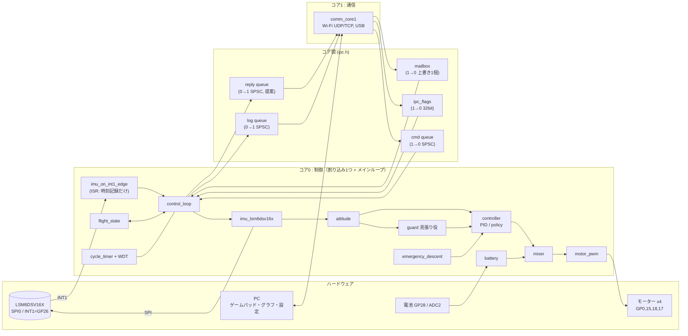

# 初代C ファームウェア構成（ステップ① モジュール構成とヘッダ）

正本は設計メモ rev14。メモにないことは「提案」と明記した。実装はまだ無く、`firmware/include/` のヘッダ（型と関数宣言のみ）がある。
章番号「メモN章」は設計メモの章を指す。

## ステップ②の前にオーナーに決めてほしいこと（優先順）

1. ~~**FIFO_WTM の単位**~~ → 決定（2026-11-07）: WTM=16（8組＝16ワード）。ステップ②で INT1 が約940Hz で来ることを確認する（A#4）。
2. **方策の入力数**: メモ1章は「入力14」と「15→64→64→4」で食い違う。14で作るが、15個目の正体を決める（A#2）。
3. **旗とメールボックスの重なり**: 非常停止・ディスアームを旗とパケットの旗の両方に出す案でよいか（A#3）。

## 1. 全体像



### データの流れ（要点）

| 流れ | 中身 | 形 |
| --- | --- | --- |
| IMU → 姿勢 | `imu_batch_t`（通常8組、最大32組） | 関数の引数（コア0内） |
| 姿勢 → 制御器 | `attitude_state_t` → `controller_input_t`（14個） | 同上 |
| 制御器 → ミキサー | `controller_output_t`（推力+3トルク） | 同上 |
| ミキサー → PWM | デューティ4つ | 同上 |
| PC → 機体 | 操縦パケット → mailbox / 旗 / コマンド | コア間（メモ4章） |
| 機体 → PC | `log_record_t`（1周期1件、通し番号付き） | log queue |

## 2. モジュール一覧

「場所」は 割込=INT1のISR / ループ=コア0メインループの1周期の中 / 起動=起動時のみ。

| モジュール（ヘッダ） | 責務 | コア | 場所 | 根拠 | なぜ分けた／他案 |
| --- | --- | --- | --- | --- | --- |
| `imu_lsm6dsv16x.h` | SPI0でIMUを設定、INT1待ち、FIFO全読み | 0 | 割込(時刻記録のみ)+ループ | 2,3章 | ステップ②の単体試験の単位。ISRで読む案は、読み出し約160µsの間ほかの割り込みを止めるので不採用 |
| `attitude.h` | IMU生値→姿勢角・角速度 | 0 | ループ | 1章 | 制御器の外に置く（メモ決定）。制御器の中に入れるとPIDと方策で推定が別物になり比べられない |
| `controller.h` | 入力14/出力4の共通口（ops表） | 0 | ループ | 1章 | switchでなく関数ポインタ表。制御器が増えても呼び出し側が変わらない |
| `controller_pid.h` | PID（角度→角速度のカスケード、提案） | 0 | ループ | 1,5章 | 降下は必ずPIDなので常に使える状態にしておく |
| `controller_policy.h` | 全結合NN、重みの受信・切替 | 0 | ループ | 1,4章 | 重みは2面(受信用/使用中)。受信途中の重みで飛ばないため |
| `guard.h` | PIDの見張り役。取り上げ判定とラッチ | 0 | ループ | 5章 | FSMと別にした。FSMは機体の状態、guardは「どちらの制御器か」で、遷移表が混ざると読めなくなる |
| `emergency_descent.h` | 降下の目標推力と着地検出 | 0 | ループ | 5章 | FSM内に書くと数値(試験で変わる)が遷移表に混ざる |
| `mixer.h` | 推力+トルク→4デューティ | 0 | ループ | 1章 | 純粋関数。PCで単体試験できる |
| `motor_pwm.h` | 20kHz PWM出力、全停止 | 0 | ループ(起動で初期化) | 1章 | ミキサーとPWMを分けるのは、非常停止が「PWMを直接0」にできるようにするため |
| `battery.h` | ADC2の計測、低下判定 | 0 | ループ(数周期に1回) | 1,5章 | 担当コアはメモに無い。電池低下は降下のきっかけなので安全系と同じコア0にした(提案) |
| `flight_state.h` | 状態6つ、遷移、停止理由 | 0 | ループ | 5章 | 入力構造体→次状態の純粋関数にしてPCで試験する |
| `cycle_timer.h` | 時計、周期ごとの開始時刻・処理時間、WDT | 0 | ループ | 2章 | SDKの`watchdog_*`と名前が衝突しないよう`fc_`を付けた |
| `control_loop.h` | 上記の呼び出し順を持つ | 0 | ループ | 2,3章 | 各モジュールは互いを呼ばず、ここだけが順序を知る |
| `params.h` | ゲイン・配置・推力特性・電圧範囲・しきい値 | 0が所有 | 起動+待機中のコマンド | 1,4章 | 1か所にまとめる(メモ決定)。コア1は触らない=競合なし |
| `mailbox.h` `control_packet.h` | 操縦内容の受け渡し | 書く=1 読む=0 | 受信時 / ループ | 4章 | 上書き1個。古い操縦は意味がないのでキューにしない |
| `ipc_flags.h` | 非常停止・ディスアームの旗 | 立てる=1 下ろす=0 | 同上 | 4章 | 最新値でなく「要求があった」を落とさないため、メールボックスとは別 |
| `spsc_ring.h` `cmd_msg.h` `log_record.h` `ipc.h` | キュー本体、メッセージ型、ログ/コマンド/返信の入口 | 0⇄1 | ループ / コア1のループ | 4章 | 満杯時の方針だけ`ipc.h`の関数側に持たせ、リングは中立にした |
| `comm_core1.h` | Wi-Fi(UDP/TCP)とUSB、パケット変換 | 1 | コア1のループ | 3,6章 | 変換関数を純粋関数にしてPCで試験する |
| `board_pins.h` | ピン定数 | - | - | 1章 | 変更不可の値を1か所に |

SDK依存: ヘッダはどれもSDKの型を使わない（`uint`などを出さない）。ISRのコールバックは`.c`側でSDKの形に合わせ`imu_on_int1_edge()`を呼ぶ。理由は、PCで構文・単体試験でき、SDKのバージョン差がヘッダに波及しないため。

## 3. 1周期の流れ（INT1の立ち上がり〜PWM更新）

| # | 呼び出し | 備考 |
| --- | --- | --- |
| 0 | `imu_on_int1_edge()` **[ISR]** | 時刻と回数を記録するだけ。SPIはしない |
| 1 | `imu_wait_int1(5000µs)` → `cycle_timing_begin()` | 返らなければタイムアウト処理(飛行中なら`motor_pwm_stop`→非常停止) |
| 2 | `ipc_cmd_pop()`×最大4 → `params_set_by_id` / `policy_stage_chunk` 等 → `ipc_reply_push()` | メモ4章「ループの最初」。待機中のみ受付 |
| 3 | `ipc_flags_estop_requested()` `ipc_flags_disarm_pending()` `mailbox_seq()` `mailbox_read()` | 新しいseqなら`last_new_packet_us`更新。通信途絶はここで判定 |
| 4 | `imu_read_fifo()` | 約160µs（再見積もり）。失敗が続けばIMU途絶 |
| 5 | `attitude_update_batch()` | バッチ内の全サンプルで更新 |
| 6 | `battery_update()` | 数周期に1回 |
| 7 | `flight_fsm_step()` | 状態遷移。降下に入る周期は`descent_begin()` |
| 8 | 制御器の選択: FLIGHT=選んだ方／降下=PID。方策使用中は`guard_check_pre()` | |
| 9 | `controller_input_pack()` → `step()`（方策なら時間計測）→ `guard_check_post()` | 取り上げなら影PIDの出力を採用 |
| 10 | `mixer_mix()` → `motor_pwm_set()`（モーター停止状態なら`motor_pwm_stop()`） | ここで「周期終了」 |
| 11 | `cycle_timing_end()` → `ipc_log_push()` → `fc_wdt_feed()` | ログとWDTはPWM更新の後。処理時間にはログ組み立てを含めない |
| 12 | `imu_int1_pin_is_high()` を確認 | 立ち上がりを取りこぼして止まるのを防ぐ(#10) |

予算の目安: FIFO約0.16ms + 方策0.18ms（見積もり） + 他 → 1.04msに収まるかは実測で確定（メモ2章の条件）。

**INT1の割り込みの中か、ループの中か**: メモは「INT1でループを回す」としか書いていない（#11）。提案は「ISRは記録だけ、処理はメインループ」。他案の「ISRの中で全部処理」は、約0.4ms以上ほかの割り込みを止め、INT1がまた来てもネストの扱いが難しいため採らない。

## 4. 実装順とヘッダの対応

| ステップ | 実装する | 使うヘッダ |
| --- | --- | --- |
| ② IMUのFIFO読み出し | WHO_AM_I→FIFO設定→INT1→全読み | `board_pins.h` `fc_types.h` `imu_lsm6dsv16x.h` `cycle_timer.h`(時計のみ) |
| ③ 制御ループ | 姿勢→PID→ミキサー→PWM、FSM、タイミングログ | `attitude` `controller*` `mixer` `motor_pwm` `params` `flight_state` `guard` `emergency_descent` `battery` `control_loop`（目標はダミー値） |
| ④ コア間リングバッファ | リング、ログ、コマンド、コア1 | `spsc_ring` `log_record` `cmd_msg` `ipc` `ipc_flags` `mailbox` `control_packet` `comm_core1` |

## 5. 矛盾しそうな点・決まっていない点

### A. メモ内の矛盾・古い数字

| # | 内容 | 提案 |
| --- | --- | --- |
| 1 | メモ2章の「SPI 5MHzで1ワード約14µs、約225µs」は古い。7.5MHzでは1ワード約10µs、16ワードで約160µs（ビット時間だけ比例すると仮定した再見積もり）。また1.04msは960Hz設定値で、実周期は約1.064ms | 実測で更新。ヘッダのコメントは約160µs |
| 2 | メモ1章は入力14個なのに、方策の式は「15→64→64→4で5312積和」。14入力なら5248積和、重みは約21.5KB(5380個)。5312は15入力の値 | 14で作る（マクロ`FC_CONTROLLER_INPUT_DIM`）。15個目が何かを確認 |
| 3 | メモ4章の表は「非常停止・ディスアームは旗、アーム要求はメールボックス」。メモ6章・8章(2026-11-06)は「3つとも操縦パケットの旗」で「4章を変更」とある | 提案: 同じパケットの旗をコア1が両方に出す（メールボックスにパケット全体、非常停止/ディスアームは旗にも）。メールボックスは上書きで取りこぼし得るが、旗は残る |
| 4 | ウォーターマーク「8サンプル」。FIFO_WTMの単位はワード（TAG＋1センサー6バイト。ST公式サンプル lsm6dsv16x_fifo.c のコメントで確認）。ジャイロ1+加速度1で2ワードなので、8だと4組＝約1880Hz | **決定（2026-11-07）**: WTM=16。設計メモ2章も修正済み。ステップ②の合格条件に「INT1が約940Hz」を入れる。`imu_config_t.fifo_watermark_words`で持つ |
| 5 | 非常停止の理由に「通信途絶」とあるが、5章では通信途絶は非常時降下に入る（非常停止は着地/時間切れ後） | 降下の原因(`descent_reason_t`)と停止理由(`estop_reason_t`)を別に持ち、ログに両方出す |
| 6 | 5章に「人の指示」で取り上げるとあるが、6章の操縦パケットにその項目が無い | `CTRL_FLAG_TAKEOVER_PID`を追加（提案） |
| 7 | 6章は「受付／拒否を返す」とあるが、4章にコア0→1の返信経路が無い | 返信キューを追加（ログと分けるのは、ログは捨てるが返信は捨てたくないため） |
| 8 | 4章「コマンドが満杯ならコア1が空くまで待つ」。コア1が待つとUDP受信(非常停止含む)も止まる。コア0は非常停止中などループの最初が回らない時がある | `ipc_cmd_push_wait`に時間切れを付け、コア1はネットワーク処理を回しながら再試行（提案） |
| 9 | 4章「旗は32ビット1つ、立てるのはコア1、下ろすのはコア0」。同じ語を両コアが読み-変更-書きすると、コア1の「立てる」がコア0の「下ろす」で消えるおそれがある | 語を3つに分け、どれも書く人を1人にする: `estop`（コア1だけ、0→1にするだけ。非常停止は抜けないので下ろさなくてよい）、`disarm_req`（コア1だけが+1するカウンタ）、`disarm_ack`（コア0だけが処理時に`disarm_req`を写す）。未処理のディスアーム=`disarm_req != disarm_ack`で、何回来ても1回分として処理され取りこぼさない（反転式は、読む前に2回反転すると0回に見えて消えるので不採用）。アトミックRMW(`fetch_or`/`fetch_and`)案は、RP2350のコア間排他モニタの動作をデータシートで確認する必要があり、spsc_ringの「1変数1ライター」と考え方がそろわないため選ばなかった |

### B. 決まっていない点（実装前に決めたい）

| # | 項目 | 提案・メモ |
| --- | --- | --- |
| 10 | INT1は立ち上がりエッジ。読み終えてもFIFOがウォーターマーク以上だとピンがHighのままで次のエッジが来ない | 読み後に`imu_int1_pin_is_high()`確認。タイムアウト5msでも気づける |
| 11 | ISRの中で処理か、ループか | ISRは記録だけ（3章） |
| 12 | 遅れて2周期ぶん溜まったとき、制御は1回かN回か | 姿勢推定はサンプル全部、制御器は1周期1回（提案） |
| 13 | 方策使用中のPIDを回すか | 影として毎周期回す（取り上げ時の積分が冷えない／計算時間超過のその周期の出力に使える）。計算コストは小 |
| 14 | 姿勢推定のアルゴリズム、ジャイロのバイアス補正、ヨーの基準（磁気なし）、軸・単位・IMUの取り付け | 単位はrad, rad/s, g, N, N·m（提案）。バイアスは待機中に推定 |
| 15 | 制御器入出力の正規化。前回出力は指令後の値か | 前回出力は上限処理後の値。正規化は`policy_norm_params_t`、活性化関数は学習側と決める |
| 16 | 目標ヨーは角度か角速度か。スロットル(0..1)→推力(N)の換算 | `max_total_thrust_n`で換算。ヨーはPC側で積分し角度で渡す（提案） |
| 17 | ミキサーの飽和優先、電圧補償、推力特性の形 | 推力特性は折れ線テーブルで始める。電池電圧は引数に入れてある |
| 18 | 時間のしきい値: 通信途絶、WDT、電池低下、降下スロットル比・上限時間 | `params.h`に置く。初期値は.cで仮置き |
| 19 | 非常停止中のループの回し方（IMUが死んでいてINT1が来ない） | 時間基準の周期で回してログとWDT餌やりを続ける（メモは「PCへ送り続ける」） |
| 20 | 「PCとつながった」の定義。待機・通信待機での通信途絶の扱い | 最初の有効パケット受信。待機中の途絶は通信待機へ戻す案 |
| 21 | Wi-FiはAP/ステーション、ポート、パケット形式、CRC、USBの用途 | ワイヤ形式は`comm_*`の変換関数に閉じ込めた。USBは当面デバッグ表示（提案） |
| 22 | ログ量: 1周期1件(約100B)×940Hzは約94KB/s | ログは間引き可能に（提案）。まず実測 |
| 23 | パラメータの永続化(フラッシュ保存) | 当面は起動のたびに既定値＋TCPで設定 |
| 24 | モーター駆動ゲートの起動時・WDTリセット時の電位（ハード側） | TODO: 回路図確認。リセット中にモーターが回らないか |
| 25 | FIFO読み出しの方式（1回のバースト、DMA） | まずポーリングの単純な形。DS確認 |

### C. メールボックス: オーナー実装との差分（`mail_box.c` を読んで）

オーナー実装は `Drone {roll, pitch, yaw, throttle}` を `mailbox_write(Drone)` / `mailbox_read(Drone*)` で渡す（書く側は割り込み禁止、`seq`の前後に`__dmb()`）。ヘッダ`mailbox.h`はこの関数形に合わせた。差分:

| 項目 | owner版 | 設計メモ4章・6章 | 提案 |
| --- | --- | --- | --- |
| ペイロード | roll/pitch/yaw/throttle のみ | アーム要求もメールボックスで渡す(8章 2026-11-06)。ディスアーム・非常停止も旗として毎回送る | `control_packet_t`に`flags`（ARM_REQ/DISARM/ESTOP/TAKEOVER_PID）と`packet_seq`を追加 |
| 型名 | `Drone`（グローバル） | - | `control_packet_t`（`control_packet.h`）。`Drone`のままだとコア1の受信側も機体の名前を借りることになり、パケットと機体が混ざる |
| 変数 | `volatile uint32_t seq; Drone data;`（非static・グローバル） | - | `mailbox.c`内で`static`にし、外からは関数だけで触る。名前が`seq`/`data`だと他のモジュールと衝突しやすい |
| 引数 | `mailbox_write(Drone)` 値渡し | - | `const control_packet_t *`（サイズが増えるため） |
| 新しいか | `mailbox_read`はseqを返さない | 通信途絶の判定はコア0 | `uint32_t mailbox_seq(void)`を追加。前回と違えば新着。0は未受信 |
| 読み側の待ち | 書き込み中は無限に再試行 | - | 書く側は割り込み禁止の短い区間なので当面そのまま。気になれば回数上限を付ける |
| 戻り値 | `int`（常に0） | - | そのまま維持 |

## 6. ディレクトリ構成（想定）

```
drone_1st/
  docs/architecture.md
  firmware/
    include/          ← 今回作った .h
    src/              ← 今後。main.c, imu_lsm6dsv16x.c, control_loop.c, ... ヘッダと1対1
    test/             ← 提案: PCで試す純粋モジュール（mixer, flight_state, guard, spsc_ring, comm_*）
    CMakeLists.txt    ← 今回は作らない（PICO_BOARD=pico2_w）
```

起動の流れ（`main.c`、提案）: コア0で `params_set_defaults` → `ipc_init` → `multicore_launch_core1(comm_core1_entry)`（Wi-Fi/USB初期化はコア1の中） → `control_loop_init` → `control_loop_run`。WDTは初期化が済んだ後に開始し、餌やりはコア0だけが行う（コア1の停止は通信途絶として検出する）。
